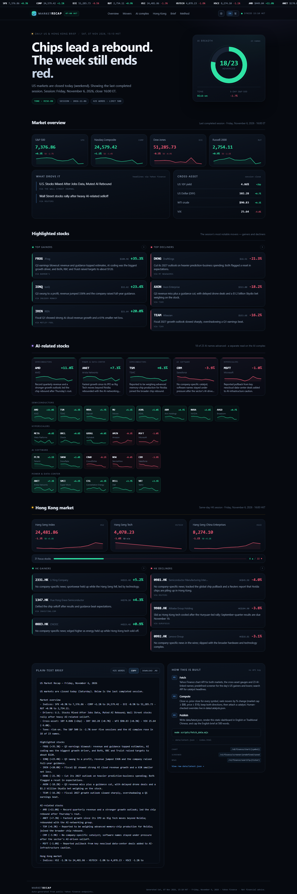
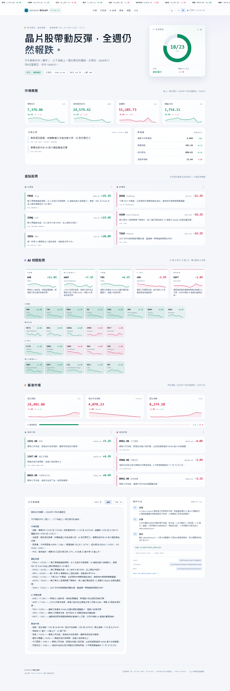

# Market Recap — US + Hong Kong

A one-page daily dashboard built around `AGENTS.md`: the last completed US session (indices, notable gainers **and** decliners, a separate AI section) plus a same-day Hong Kong section, a plain-text brief capped at 500 words, a **light/dark** switch and a **English / 繁體中文** switch.

**Live:** https://joseph-aiclass.github.io/market-recap/





## Run it

```bat
:: open the dashboard (starts a local server if needed, then opens the browser)
scripts\view.cmd
```

That is the only step you need day to day. It serves this folder on port 8080 and opens `http://127.0.0.1:8080/`; the server window stays minimized, and closing it stops serving. If port 8080 is busy, pass another: `scripts\view.cmd 8090`.

The page must be served over HTTP — opening `index.html` directly with `file://` fails, because `fetch()` cannot read `data/latest.json` from disk.

To refresh the data by hand instead of waiting for 07:00:

```bash
node scripts/fetch_data.mjs
```

No dependencies, no API key. Node 18+ (uses the built-in `fetch`).

## Interface

| Control | Behaviour |
| --- | --- |
| ☀︎ / ☾ (top right) | Switches dark ↔ light. Remembered in `localStorage`. Defaults to the OS preference on first visit. |
| `EN` / `繁` | Switches the whole interface and the generated brief between English and Traditional Chinese. Remembered in `localStorage`. |
| `?theme=light&lang=zh` | URL parameters override both settings for a single load (handy for sharing or screenshots). |
| Copy / Download .md | Copies or downloads the brief **in the language currently selected**. |

Third-party wire headlines stay in their original English when no checked translation exists — they are quotes, not UI text. Curated translations live in `data/catalysts.json` (`zh`) and `data/drivers_zh.json`.

## What's in the box

| Path | Purpose |
| --- | --- |
| `AGENTS.md` | The editorial spec (schedule, sections, word limit) |
| `scripts/fetch_data.mjs` | Pulls data, computes moves, writes the JSON |
| `scripts/run_daily.cmd` | Scheduler entry point; runs the fetch and logs the result |
| `scripts/view.cmd` | Opens the dashboard, starting a local server if needed |
| `logs/fetch.log` | One block per scheduled run, with its exit code |
| `data/latest.json` | Generated snapshot the page renders |
| `data/catalysts.json` | Human-checked catalyst overrides per session (`text` + `zh`) |
| `data/drivers_zh.json` | Curated Traditional Chinese translations of driver headlines |
| `index.html` / `assets/` | The dashboard (theme + language switching) |

## How the data is collected

All source data comes from public Yahoo Finance endpoints:

| Layer | Endpoint | Used for |
| --- | --- | --- |
| Chart | `query1.finance.yahoo.com/v8/finance/chart/{symbol}?range=1mo&interval=1d` | Daily closes, % change, 10-day sparklines for indices, cross-asset gauges, the 23-name AI universe and 31 HK stocks |
| Screener | `query1.finance.yahoo.com/v1/finance/screener/predefined/saved?scrIds=day_gainers\|day_losers` | The session's biggest US movers |
| Search | `query1.finance.yahoo.com/v1/finance/search?q={ticker}&newsCount=...` | Catalyst headlines, used verbatim unless overridden |

Symbols:

- **US indices:** `^GSPC`, `^IXIC`, `^DJI`, `^RUT`
- **Cross-asset:** `^TNX` (quoted directly as the 10Y yield in percent), `DX-Y.NYB`, `CL=F`, `^VIX`
- **Hong Kong:** `^HSI`, `HSTECH.HK`, `^HSCE`, plus 31 liquid HK names from `0700.HK` to `2331.HK`
- **AI universe:** fixed 23 names in semiconductors, hyperscalers, AI software, and power/data-center

Processing rules:

- US session date comes from the last daily bar of `^GSPC` in `America/New_York`; HK uses `Asia/Hong_Kong`.
- % change = last close vs. previous close (not the intraday quote).
- US movers must be equities with price ≥ $10 and market cap ≥ $8B; the top three in each direction are kept, so the list always has gainers and decliners.
- Hong Kong has no equivalent public screener, so the HK movers are ranked inside a fixed 31-name watchlist (the full list is in `scripts/fetch_data.mjs`). Breadth counts every name in that list.
- `HSTECH.HK` only exposes a single daily bar, so that card falls back to Yahoo's `regularMarketPrice` / `chartPreviousClose` pair and shows `n/a` for the 5-day change.
- `data/catalysts.json` lets a human replace a noisy auto-selected headline with a checked one-liner for a given session date; `zh` carries the Traditional Chinese version. Delete an entry to fall back to automation.
- `data/drivers_zh.json` does the same for the two macro-driver headlines, keyed by session date and exact English headline.

## Scheduling

The daily snapshot is refreshed **in the cloud**, not on this machine:

| | |
| --- | --- |
| Workflow | `.github/workflows/update-data.yml` (`Update market data`) |
| Runs | `0 23 * * *` UTC = 07:00 Asia/Hong_Kong daily, on GitHub's runners |
| Does | `node scripts/fetch_data.mjs`, then commits `data/latest.json`; Pages redeploys |
| Check | `gh run list --workflow update-data.yml --repo joseph-aiclass/market-recap` |

Because it runs on GitHub, the site keeps updating when this PC is off, asleep, or offline.

Inspect or trigger it:

```powershell
gh run list  --workflow update-data.yml --repo joseph-aiclass/market-recap
gh workflow run update-data.yml --repo joseph-aiclass/market-recap
gh run view <run-id> --repo joseph-aiclass/market-recap --log
```

### Local task (disabled)

A Windows task named `MarketRecap 0700 HKT` also exists but is **disabled**, so it cannot race the workflow and write a second commit for the same snapshot. It is kept for manual runs:

```powershell
Get-ScheduledTaskInfo -TaskName "MarketRecap 0700 HKT"      # LastRunTime, LastTaskResult
Start-ScheduledTask    -TaskName "MarketRecap 0700 HKT"     # run now; fetches, commits, pushes
Enable-ScheduledTask   -TaskName "MarketRecap 0700 HKT"     # re-enable — then disable the workflow
```

If you ever switch back to it, disable the workflow first. `scripts\run_daily.cmd` rebases before pushing, so a clash no longer deadlocks the clone, but it still adds a redundant commit.

Manual refresh with no scheduler involved:

```powershell
node scripts/fetch_data.mjs
git add -A; git commit -m "data: manual refresh"; git push
```

## When a run fails

The page is designed to look wrong when the data is wrong, rather than quietly showing less:

- `scripts/fetch_data.mjs` writes `data/latest.json` through a temp file and rename, so an interrupted run can never leave half-written JSON behind.
- Every symbol that fails is recorded in `meta.failures` instead of being dropped silently. The dashboard then shows a notice naming the missing tickers (`2 of 56 tracked symbols failed to fetch…`).
- If more than three symbols fail, the script exits **1**, and `run_daily.cmd` marks the run as degraded in `logs/fetch.log`.
- The page compares `meta.generatedAt` with the current time and shows a **stale** notice once the snapshot is more than 36 hours old — the signal that the 07:00 job has stopped running.


## Notes

- Yahoo's endpoints are public but unofficial; shapes can change without notice.
- At 07:00 HKT the US session that just closed is the same calendar date as the HK session that closed the previous afternoon, so both sections normally describe the same date.
- Headlines are third-party content and are shown with attribution.
- Not financial advice.
